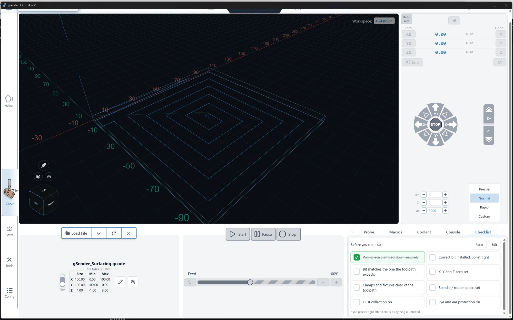
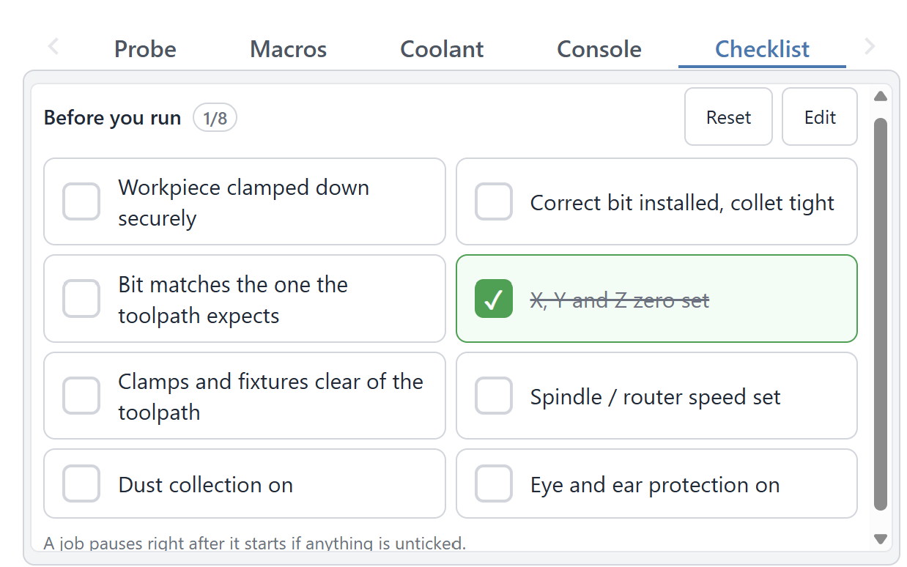
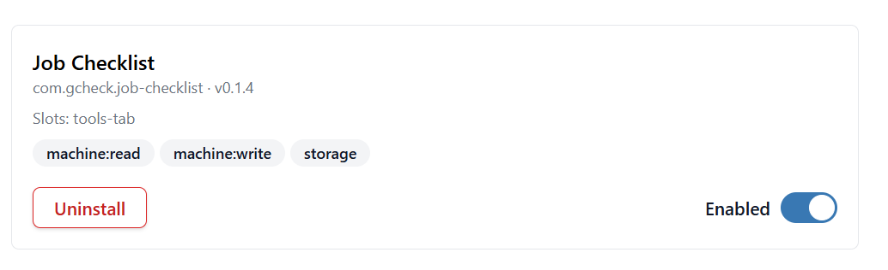

# GChecklist (gSender plugin)

A pre-job checklist for [gSender](https://github.com/Sienci-Labs/gsender). It lives as a **Checklist** tab in the Tools panel on the Carve screen, so you can tick off your setup steps before every job, and it can pause a job that starts before everything is ticked.



## Features



- **Touch-friendly list:** every item is a large button, laid out in two columns when the panel is wide enough. Tap to tick, tap again to untick.
- **Reset** clears all ticks.
- **Edit** lets you add, remove, reorder and rename items, plus the options below. gSender saves everything.
- **When a job starts:**
  - *Pause if anything is unticked* (default): the job is paused right after it starts, and the tab shows the list with **Continue job** and **Stop job** buttons.
  - *Always pause and ask*: pauses every job.
  - *Don't pause*: the list is just a reminder.
- **Clear ticks when a job finishes** (default on): every job starts with a fresh list. Ticks are kept if you press **Stop job** in the prompt, so you don't lose what you'd already checked.
- **Beep when pausing a job** (default on).
- **Test pause prompt** (in Edit) shows the prompt and plays the beep without a job, so you can see what it looks like. No commands are sent to the machine.

## Limits

gSender doesn't let plugins step in before a job starts, so GChecklist pauses the job as soon as gSender reports that it's running.

- A few lines of G-code may already have been sent by then. The spindle may be on and the first move may have begun. Treat this as a safety net, not a replacement for checking before you press Start.
- Plugins can't show pop-ups over gSender. The prompt appears inside the Checklist tab, so keep that tab selected in the Tools panel if you want to see it. The beep helps when it isn't.
- If you resume or stop the job with gSender's own buttons instead, the prompt closes by itself.

## Install

1. Build it (needs Node.js 18+):
   ```
   npm install
   npm run package
   ```
   This creates `release/gchecklist/` and `release/gchecklist.zip`.
2. Copy the `release/gchecklist` folder into gSender's plugins folder:
   - Windows: `%APPDATA%\gSender\plugins\`
   - macOS: `~/Library/Application Support/gSender/plugins/`
   - Linux: `~/.config/gSender/plugins/`

   The exact path is also shown under **Tools → Plugins**, which also has an install option for the zip.
3. Restart gSender. Check that **GChecklist** is enabled under **Tools → Plugins**:

   

4. On the Carve screen, open the **Checklist** tab in the Tools panel. If you don't see it, scroll the tab row with the arrow at its right end.

Needs a gSender build with plugin support (the manifest asks for `>=1.6.0`; tested on 1.7.0 Edge). The plugin asks for permission to read machine events, send pause, resume and stop commands, and save its own settings.

## Develop

`npm run watch` rebuilds `ui/` on every change. If this folder is inside a gSender dev checkout's `plugins/` folder, the open tab reloads by itself.
